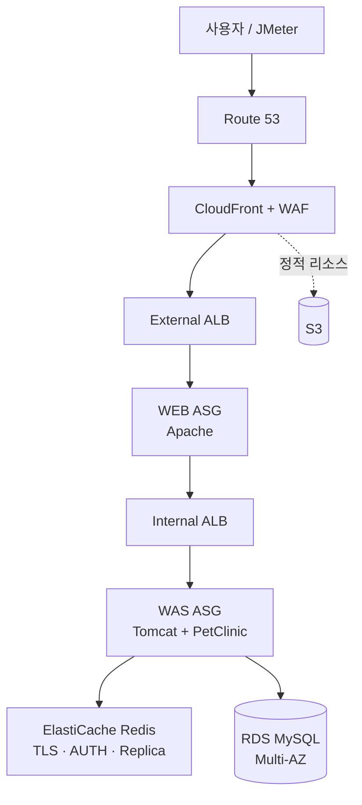

# 🐾 PetClinic on AWS: 3-Tier 인프라 구축 (AWS 2Team · CORE)

베스핀글로벌 멀티클라우드 엔지니어 부트캠프 6기 **[10] 클라우드 인프라 구축 프로젝트** 결과물입니다.
Spring PetClinic(WAR)을 AWS 위에 **WEB(Apache) – WAS(Tomcat) – DB(RDS MySQL)** 3-Tier로 올리고, 트래픽 급증 시나리오에 맞춘 오토스케일링·캐시·모니터링을 설계하고 부하 테스트로 검증했습니다.

> 애플리케이션 코드는 강의용 원본 [SteveKimbespin/petclinic_btc](https://github.com/SteveKimbespin/petclinic_btc)(Spring Framework PetClinic)를 포크한 것입니다. 원본 실행 방법은 맨 아래에 남겨 두었습니다.

---

## 1. 시나리오: "원장 인터뷰 방송 → 기사화 스파이크"

병원장이 방송에 출연해 특이 진료 사례가 소개된 상황을 가정했습니다.

| 단계 | 상황 | 트래픽 특징 | 검증 포인트 |
|------|------|-------------|-------------|
| 1차 | 방송 중~직후, 시청자 일부가 검색 | 완만한 증가 (예측 가능) | 스케일링 정책이 과잉 반응하지 않는가 |
| 2차 | 관련 기사 게재·확산 | 급격한 스파이크 (예측 불가) | 제때 스케일아웃하고, 끝나면 스케일인하는가 |

방영 시각은 알 수 있지만 기사 확산의 규모와 속도는 알 수 없다는 점에서, **반응형 오토스케일링**을 검증하기에 맞는 시나리오로 판단했습니다.

## 2. 아키텍처



| 계층 | 구성 |
|------|------|
| 네트워크 | VPC, Public/Private 서브넷(2 AZ), NAT Gateway, S3 Gateway Endpoint |
| 엣지·보안 | Route 53, CloudFront, AWS WAF, ACM, KMS, Security Group 체인 |
| WEB | Apache on EC2 Auto Scaling Group (External ALB 뒤) |
| WAS | Tomcat + PetClinic WAR on EC2 Auto Scaling Group (Internal ALB 뒤) |
| 데이터 | RDS MySQL Multi-AZ(암호화), ElastiCache for Redis(TLS + AUTH) |
| 비밀 관리 | SSM Parameter Store (SecureString) |
| 접속 | SSM Session Manager (Private 서버에 SSH 키 없이 접속) |
| 운영 | CloudWatch(지표·대시보드·알람), SNS, CloudTrail → S3(라이프사이클) |

## 3. 팀 구성

| 이름 | 역할 | 담당 |
|------|------|------|
| 유현하 | Leader | 네트워크, 보안 (Route 53, CloudFront, WAF, KMS, 백업) |
| 설동화 | Actioner | WEB (Apache, External ALB) |
| 이지형 | Analyst | WAS (Tomcat 런타임, JMeter 테스트 플랜) |
| **오민희** | Writer | **DB, 모니터링** (RDS, ElastiCache, CloudWatch, CloudTrail, 비용) |

## 4. 내 담당: DB · 캐시 · 모니터링

### RDS MySQL
- **Multi-AZ + 암호화**, DB 서브넷 2개(AZ-a, AZ-c, Private)
- 접속 정보는 **Parameter Store SecureString**에 두고, WAS 기동 시 `-Djdbc.*` 시스템 프로퍼티로 주입
- ASG가 새로 띄우는 인스턴스도 RDS를 쓰도록 앱 설정을 **골든 AMI / 시작 템플릿 user-data**에 반영
- **커넥션 용량 점검**: `db.t3.micro`의 `max_connections` 기본값은 61인데 앱 풀은 인스턴스당 `maxActive=30`. WAS가 3대 이상으로 스케일아웃하면 연결이 부족해지므로, 풀 축소 또는 인스턴스 클래스 상향을 결정 사항으로 남김

### ElastiCache for Redis
- TLS + AUTH 토큰(Parameter Store) 적용, Primary/Replica 구성
- **페일오버 테스트**: WAS에서 1초 간격 `PING` 루프를 돌리며 장애 조치 중 응답 중단 구간을 측정

### CloudWatch · 로깅
- 테스트 단계별 **CloudWatch 대시보드**, SNS 알람, 비용 대시보드 구성
- 알람을 두 종류로 구분
  - **자동 대응형**: ASG 스케일링 정책에 연결 (예: `ALBRequestCountPerTarget`)
  - **수동 대응형**: SNS 알림 후 사람이 원인 확인
- 계층별 로그 설계

| 계층 | 로그 | 용도 |
|------|------|------|
| WEB (Apache) | access / error log | 요청 확인, ProxyPass 실패 원인 |
| WAS (Tomcat) | catalina.out, access log | 5xx 스택트레이스 |
| RDS | error / slow query log | 쿼리 지연, 연결 실패 원인 |
| ALB | access log | 요청 단위 추적 (지표는 집계값) |
| ASG | Activity History | 어떤 알람으로 스케일아웃/인 했는지 |

- **CloudTrail** → S3 저장, 라이프사이클 정책으로 보존 기간 관리

## 5. 부하 테스트 설계 (JMeter)

- 테스트 플랜: [`src/test/jmeter/petclinic_test_plan.jmx`](src/test/jmeter/petclinic_test_plan.jmx)
- 시나리오 요청: 메인, 보호자 검색·목록·상세, 수의사 목록, 방문 기록 조회·등록(POST)
- **think time 5초** (사람이 페이지를 보고 클릭하는 현실적인 속도)

| 단계 | VU | 처리량 | 근거 |
|------|----|--------|------|
| 2. 방송 중 완만한 증가 | 200 | 35.4 RPS 고정 | 200 VU × think time 5초의 자연 처리량 한계 (200 ÷ 5.646초) |
| 3. 기사 확산 스파이크 | 1,300 | 150 RPS 고정 | 스케일아웃 조건(타깃당 4,000/분, 3분 연속)을 안정적으로 넘기기 위해 캡 고정 |
| 4. 감소 구간 | 500 → 250 → 20 | VU에 비례해 감소 | 스레드당 0.1154 RPS 유지 → 스케일인 조건 확인 |

> 3단계를 고정 캡으로 둔 이유: 캡 없이 돌리면 처리량이 4,138 → 3,128 → 4,308/분처럼 들쭉날쭉해서 "3분 연속 초과" 조건을 채우지 못하는 경우가 있었습니다.

## 6. 트러블슈팅

| 이슈 | 영역 |
|------|------|
| SSM 접속 이슈 | 접속 |
| WEB ↔ WAS 연동 실패 / Timeout | WEB·WAS |
| IAM 인스턴스 프로파일 S3 권한 누락 | IAM |
| 도메인 연결 후 504 Gateway Timeout | 네트워크·ALB |
| CloudFront 이미지 접근 시 403 AccessDenied | CloudFront·S3 |

<!-- TODO: 각 이슈의 원인 → 해결을 한 줄씩 추가 -->

## 7. 결과와 회고

<!-- TODO: 부하 테스트 결과(스케일아웃 시점, 응답 시간, 에러율), 페일오버 측정값, 배운 점을 채워 주세요 -->

---

<details>
<summary>원본 PetClinic 실행 방법 (강의 제공 README)</summary>

## Running petclinic locally

### Tomcat 설치 및 Start
Tomcat 설치 가이드를 참조하여 Tomcat 설치 후, tomcat-users.xml 에 User 및 Role 추가

[ Ubuntu 18.04 : Tomcat 9 설치하는 방법 ](https://jjeongil.tistory.com/1351)

Tomcat User 및 Role 추가

```
# $TOMCAT_HOME/conf/tomcat-users.xml 파일에 아래 행들을 추가

    <role rolename="manager-script"/>
    <role rolename="manager-gui"/>
    <role rolename="manager-jmx"/>
    <role rolename="manager-status"/>
    <user username="tomcat" password="tomcat" roles="manager-gui,manager-script,manager-status,manager-jmx"/>
```

Tomcat 을 실행 ( 위의 Tomcat 설치 가이드를 통해서 이미 실행되어 있는 경우에는 Skip )

```
$TOMCAT_HOME/bin/catalina.sh start
```

### Tomcat 배포 ( H2 In-memory Database 활용 )
```
git clone https://github.com/SteveKimbespin/petclinic_btc.git 
cd petclinic_btc
./mvnw tomcat7:deploy
```

You can then access petclinic here: [http://localhost:8080/petclinic](http://localhost:8080/petclinic)


### 외부에 구성한 MySQL Database 연결 방법

MySQL 을 각 CSP 의 DB Service 로 구성
  - database 명 : petclinic  
  - db user 및 password 설정

MySQL database 접속 설정을 하기 위해, pom.xml 파일에 정의 된 'MySQL' profile 을 아래와 같이 수정후, 재배포(redeploy)한다.
  - jdbc.url 부분에 정의되어 있는 DNS 또는 IP Address 를 연결하고자 하는 MySQL IP 로 변경한다. ( 필요시 database 도 수정)
  - db 접속 User ID 및 Password 수정

```
<properties>
    <jpa.database>MYSQL</jpa.database>
    <jdbc.driverClassName>com.mysql.cj.jdbc.Driver</jdbc.driverClassName>
    <jdbc.url>jdbc:mysql://localhost:3306/petclinic?useUnicode=true</jdbc.url>
    <jdbc.username>petclinic</jdbc.username>
    <jdbc.password>petclinic</jdbc.password>
</properties>
```      

Tomcat 에 재배포

```
# 기존에 배포되어 있는 환경에 MySQL 연결 설정 수정후, 재배포 하는 경우
./mvnw tomcat7:redeploy -P MySQL

# 최초 배포하는 경우
./mvnw tomcat7:deploy -P MySQL
```


You can then access petclinic here: [http://localhost:8080/petclinic](http://localhost:8080/petclinic)


</details>

## License

원본 Spring PetClinic과 동일하게 [Apache License 2.0](LICENSE.txt)을 따릅니다.
